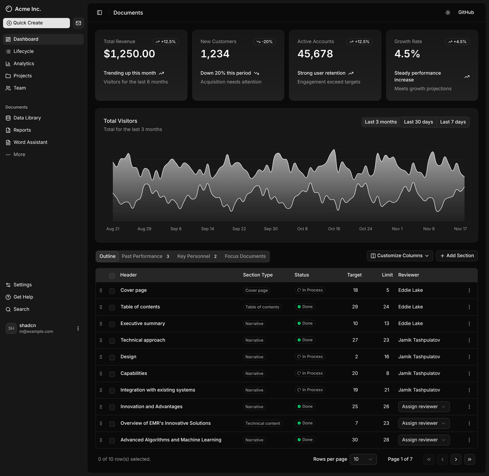

# BasecoatTheme for CakePHP 5

<picture>
  <source media="(prefers-color-scheme: dark)" srcset="https://raw.githubusercontent.com/delamux/cakephp-basecoat-theme/main/docs/screenshots/dashboard-dark.png">
  
</picture>

| Light | Dark |
| --- | --- |
|  |  |

A CakePHP 5 **theme plugin** for [Basecoat UI](https://basecoatui.com) (the shadcn/ui look, no React).
Every Basecoat component has its **own View Helper**, and every helper can be parametrized with
classes, variants, sizes, attributes and string templates.

**Component catalog:** every helper with live examples, their PHP code and the rendered HTML, plus a
demo dashboard built only with these helpers: <https://delamux.github.io/cakephp-basecoat-theme/>.

- Theme: layouts (`default` dashboard with inset sidebar, `auth`, `error`), sidebar/user menu elements and flash elements.
- 34 helpers: Accordion, Alert, Avatar, Badge, Breadcrumb, Button, ButtonGroup, Card, Chart,
  ChoiceCards, CommandMenu, Conversation, DateRangeField, Dialog, DropdownMenu, EmptyState, Form, Icon,
  Kbd, MemberList, MetricCard, NotificationList, PageHeader, Pagination, Progress, Sidebar, Skeleton, Table,
  TableToolbar, Tabs, Theme, Toast, Tooltip, WorkspaceSwitcher.
- Ready-made screens: `bin/cake bake screen users` bakes a controller and a template you own (see
  [Screens (bake)](#screens-bake)), plus Basecoat templates for the CRUD `bake all`.
- Core helper integration: `FormHelper` (Basecoat classes on every widget), `PaginatorHelper`
  templates, `FlashHelper` elements, `HtmlHelper`/`UrlHelper` for every URL and asset.
- Zero build step by default (Basecoat CSS + Tailwind v4 browser build from jsDelivr), or plug in your own compiled CSS.

Requirements: PHP 8.2+, CakePHP 5.x. Basecoat 1.1.0 markup (`data-variant` / `data-size` API).

## Installation

```bash
composer require delamux/cakephp-basecoat-theme
```

```php
// src/Application.php
public function bootstrap(): void
{
    parent::bootstrap();
    $this->addPlugin('BasecoatTheme');
}
```

In production, symlink the plugin assets (`bin/cake plugin assets symlink`).

## Use it as a theme

```php
// src/Controller/AppController.php
public function beforeRender(\Cake\Event\EventInterface $event): void
{
    parent::beforeRender($event);
    $this->viewBuilder()->setTheme('BasecoatTheme');
}
```

With the theme set, CakePHP looks for layouts and elements in the plugin first and falls back to your
app `templates/`. The default layout renders the sidebar, the sticky header (sidebar toggle, title,
theme toggle), flash messages and the toaster.

Use the auth layout for login pages: `$this->viewBuilder()->setLayout('auth');`

### Layout data

| Source (view var / `Configure`) | Purpose |
| --- | --- |
| `title` view var or `title` block | `<title>` and header heading |
| `brand` / `BasecoatTheme.brand` | `['name' => 'Fernway', 'url' => '/', 'icon' => 'circle']` |
| `sidebarMenu` / `BasecoatTheme.sidebar` | Menu for `SidebarHelper::render()` |
| `sidebarActions` / `BasecoatTheme.sidebarActions` | HTML under the brand (e.g. "Quick create") |
| `sidebarUser` | `['name', 'email', 'avatar', 'menu' => [...DropdownMenu items]]` |
| `lang` | `<html lang>` |
| `basecoatCharts` | Force loading Chart.js (auto-detected when `ChartHelper` rendered a chart) |

Blocks: `sidebar` (replace the whole sidebar), `header_actions`, `breadcrumb`, `meta`, `css`, `script`, `scriptBottom`.

```php
// config/app_local.php (or bootstrap)
'BasecoatTheme' => [
    'brand' => ['name' => 'Fernway', 'url' => '/', 'icon' => 'circle'],
    'sidebar' => [
        ['label' => 'Dashboard', 'url' => ['controller' => 'Dashboard', 'action' => 'index'], 'icon' => 'layout-dashboard'],
        ['type' => 'group', 'label' => 'Documents', 'items' => [
            ['label' => 'Reports', 'url' => ['controller' => 'Reports', 'action' => 'index'], 'icon' => 'file-text'],
            ['label' => 'Projects', 'url' => ['controller' => 'Projects', 'action' => 'index'], 'icon' => 'folder'],
        ]],
        ['type' => 'group', 'attributes' => ['class' => 'mt-auto'], 'items' => [
            ['label' => 'Settings', 'url' => '/settings', 'icon' => 'settings-2'],
        ]],
    ],
],
```

To override any theme template from your app, copy it to `templates/plugin/BasecoatTheme/...`
(e.g. `templates/plugin/BasecoatTheme/element/layout/sidebar.php`).

## Loading the helpers

Load them all in `AppView`:

```php
namespace App\View;

use BasecoatTheme\View\BasecoatHelpersTrait;
use Cake\View\View;

class AppView extends View
{
    use BasecoatHelpersTrait;

    public function initialize(): void
    {
        parent::initialize();
        $this->loadBasecoatHelpers([
            'Button' => ['size' => 'sm'],          // per-helper configuration
            'Table' => ['class' => 'text-sm'],
            // 'Form' => false,                    // keep the core FormHelper
        ]);
    }
}
```

or one by one: `$this->addHelper('BasecoatTheme.Button', ['variant' => 'outline']);`.

## Parametrizing helpers

Every component helper extends `AbstractComponentHelper` and is configurable at three levels
(lowest to highest priority):

1. **Defaults** of the helper (`$_defaultConfig`).
2. **Helper config** when loading it:

   ```php
   $this->addHelper('BasecoatTheme.Button', [
       'variant' => 'outline',                 // default data-variant
       'size' => 'sm',                         // default data-size
       'class' => 'rounded-full',              // extra classes on the root element
       'attributes' => ['data-turbo' => 'false'], // extra attributes on the root element
       'classes' => ['icon' => 'size-3'],      // extra classes on inner parts (per helper)
       'templates' => ['button' => '<button{{attrs}}>{{content}}</button>'],
   ]);
   ```

3. **Per call options**: `class` (appended), `variant`, `size`, `escape`, `templateVars`, and **any
   other key is rendered as an HTML attribute**. Inner parts take `<part>Options` arrays
   (`headerOptions`, `bodyOptions`, `footerOptions`, `triggerOptions`...).

Templates are CakePHP `StringTemplate`s, so you can also call `setTemplates()` at runtime or load
them from a config file (`'templates' => 'App.basecoat_card'`).

Text arguments (titles, labels) are escaped by default (`'escape' => false` to disable); content
arguments (card body, tab panels, dialog body, footers) are HTML and never escaped.

## Helpers reference

### Button
```php
echo $this->Button->render('Save', ['type' => 'submit']);
echo $this->Button->render('Delete', ['variant' => 'destructive', 'icon' => 'trash']);
echo $this->Button->render('Next', ['icon' => 'chevron-right', 'iconPosition' => 'end', 'variant' => 'outline']);
echo $this->Button->link('View', ['action' => 'view', $project->id], ['variant' => 'link']);
echo $this->Button->icon('panel-left', 'Toggle sidebar', ['variant' => 'ghost', 'size' => 'icon-sm']);
echo $this->Button->submit('Send');

// Icon-only below `sm` (label kept for screen readers and as `title`): ideal for `header_actions`
echo $this->Button->link('New project', ['action' => 'add'], ['icon' => 'plus', 'size' => 'sm', 'collapse' => 'sm']);
```
Variants: `primary` (default), `secondary`, `outline`, `ghost`, `link`, `destructive`.
Sizes: `xs`, `sm`, `default`, `lg`, `icon`, `icon-xs`, `icon-sm`, `icon-lg`.

`icon($icon, $label, $options)` renders an icon-only button (an `<a>` with a `url` option, `size`
defaults to `icon`). Its accessible name is `$label`, written **inside the button as visually hidden
text** (`<span class="sr-only">Toggle sidebar</span>`, always escaped) while the SVG stays
`aria-hidden="true"`, as the [Lucide accessibility guide](https://lucide.dev/how-to/accessibility)
recommends. It does not set `aria-label` any more; pass `'aria-label' => '…'` yourself if you need one
(it then takes precedence over the hidden text).
`collapse`: `sm`, `md`, `lg`, `xl` or `true` (= `sm`); ignored on buttons without icon. Classes per
breakpoint are configurable with `collapseClasses`.

Notification indicator:
```php
echo $this->Button->icon('bell', 'Notifications', ['indicator' => true]);             // dot, "New" for screen readers
echo $this->Button->icon('bell', 'Notifications', ['indicator' => $unread]);          // count badge, "3 new"
echo $this->Button->render('Inbox', ['indicator' => '9+', 'indicatorLabel' => 'Unread messages']);
```
`indicator`: `true` shows a dot, a number or string shows a count badge (the button gets `relative`).
`indicatorLabel` replaces the screen reader text (default "New" / "{0} new", pluralized; `''` for
none); on `icon()` buttons it joins the hidden name ("Notifications, 3 new"). `false`, `null`, `''`,
`0` and `'0'` render no indicator at all, so you can pass an unread count directly. Classes:
`classes.indicatorDot`, `classes.indicatorCount`.

### Badge
```php
echo $this->Badge->render('New');
echo $this->Badge->render('+12.5%', ['variant' => 'outline', 'icon' => 'trending-up']);
echo $this->Badge->render('Docs', ['url' => '/docs', 'variant' => 'link']);
```

### Alert
```php
echo $this->Alert->render('Export scheduled', 'Your workspace data will be ready in a few minutes.', ['icon' => 'info']);
echo $this->Alert->render('Sync failed', ['Renew the connector token', 'Check the warehouse permissions'], ['variant' => 'destructive']);
echo $this->Alert->success('Saved');   // also error(), warning(), info() — configurable via `types`
```

### Card
```php
echo $this->Card->render($this->element('stats'), [
    'title' => 'Quarterly bookings',
    'description' => 'Q3 2026, all plans',
    'action' => $this->Badge->render('+9.4%', ['variant' => 'outline']),
    'footer' => $this->Button->render('Details'),
]);

echo $this->Card->start(['title' => 'Team']); ?>
    ...template code...
<?= $this->Card->end(['footer' => '...']);
```

### Table
```php
echo $this->Table->render(
    [
        'title' => ['label' => 'Title', 'sort' => true],          // PaginatorHelper::sort()
        'status' => 'Status',
        'amount' => ['label' => 'Amount', 'class' => 'text-right'],
    ],
    $rows,                                                         // arrays keyed by column, `_row` = <tr> attributes
    ['caption' => 'Invoices', 'empty' => 'No results.', 'escape' => false, 'footer' => ['Total', '', '$5,936.00']],
);
```
Sortable headers show a sort indicator (`chevrons-up-down`, `arrow-up`, `arrow-down`) and the active
column gets `aria-sort="ascending|descending"`. Change the icons with the `sortIcons` config
(`['none' => ..., 'asc' => ..., 'desc' => ...]`) or pass `'sortIcons' => false` for plain links;
classes: `classes.sortLabel`, `classes.sortIcon`, `classes.sortIconActive`.

### Pagination
```php
echo $this->Pagination->render();                                      // prev, numbers, next
echo $this->Pagination->render(['first' => true, 'last' => true, 'counter' => true, 'modulus' => 3]);
echo $this->Pagination->simple();                                      // prev / next only
```
It uses the core `PaginatorHelper` (templates are pushed/popped, so `$this->Paginator` keeps its own).
To style the core helper globally: `$this->addHelper('Paginator', ['templates' => 'BasecoatTheme.paginator_templates']);`

### Form
```php
$this->addHelper('Form', ['className' => 'BasecoatTheme.Form']);

echo $this->Form->create($project);
echo $this->Form->control('name');                       // <div class="field" role="group"><label class="label">… <input class="input">
echo $this->Form->control('notes', ['type' => 'textarea']);
echo $this->Form->control('team_id');                    // select.select
echo $this->Form->control('favorite', ['type' => 'checkbox']);  // horizontal field: input + label
echo $this->Form->control('plan', ['type' => 'checkbox', 'nestedInput' => true]); // "choice card" (label wraps input)
echo $this->Form->button('Delete', ['variant' => 'destructive']);
echo $this->Form->submit('Save');
echo $this->Form->end();
```
Config: `widgetClasses` (class per widget), `button` (default `variant`/`size`), `skipClassWidgets`,
`nestedCheckboxAndRadio` (`false` by default: Basecoat styles a label that wraps its input as a
bordered "choice card", so single checkboxes/radios render input and label as siblings).
Pass `'basecoat' => false` to a control to skip the class. The control type goes in `data-type` on the
`.field` wrapper (not as a class: `textarea` / `select` are component classes and would style the wrapper). Errors render as `<p role="alert">` and
the field gets `data-invalid="true"`. Template-only alternative for the core helper:
`'templates' => 'BasecoatTheme.form_templates'`.

### Tabs
```php
echo $this->Tabs->render(['Usage' => $this->element('usage'), 'Exports' => $this->element('exports')]);
echo $this->Tabs->render([
    ['tab' => 'Outline', 'id' => 'outline', 'panel' => $table],
    ['tab' => 'Past ' . $this->Badge->render('3'), 'id' => 'past', 'panel' => '...', 'escape' => false],
], ['active' => 'past', 'variant' => 'line', 'orientation' => 'vertical']);
```

### DropdownMenu
```php
echo $this->DropdownMenu->render('', [
    ['label' => 'Edit', 'url' => ['action' => 'edit', $id], 'icon' => 'pencil', 'shortcut' => '⌘E'],
    ['type' => 'group', 'label' => 'Columns', 'items' => [
        ['type' => 'checkbox', 'label' => 'Status', 'checked' => true],
    ]],
    '-',
    ['label' => 'Delete', 'variant' => 'destructive'],
], ['align' => 'end', 'trigger' => ['variant' => 'ghost', 'size' => 'icon-sm', 'icon' => 'ellipsis', 'label' => 'Actions for ' . $project->name]]);
```
`trigger.label` names an icon-only trigger with visually hidden text inside the button (escaped).
In a table, make it unique per row ("Actions for Harbor & Pine").

### Sidebar
```php
echo $this->Sidebar->render($menu, ['header' => '...', 'footer' => '...', 'side' => 'left', 'open' => true]);
echo $this->Sidebar->toggle();
```
Item types: `item` (`label`, `url`, `icon`, `badge`, `current`), `group`, `submenu`, `separator` (`'-'`).
The current page gets `aria-current="page"` automatically (`currentMatch`: `exact` or `prefix`).

### Dialog
```php
echo $this->Dialog->render('digest-settings', $this->element('digest_form'), [
    'title' => 'Weekly digest',
    'description' => 'Choose who receives the summary email.',
    'trigger' => 'Digest settings',
    'footer' => $this->Dialog->close('Cancel') . $this->Button->submit('Save'),
]);
echo $this->Dialog->trigger('digest-settings', 'Open');
```

### Toast
```php
echo $this->Toast->toaster();   // already in the default layout
echo $this->Toast->render('Report exported', ['category' => 'info', 'description' => 'Churn forecast, November', 'action' => ['label' => 'Undo', 'url' => '/undo']]);
```

### Chart
```php
echo $this->Chart->render($rows, [
    'web' => ['label' => 'Dashboard signups', 'color' => 'var(--chart-1)'],
    'api' => ['label' => 'API signups', 'color' => 'var(--chart-2)'],
], ['type' => 'bar', 'labelKey' => 'month', 'class' => 'h-[250px] w-full', 'chartOptions' => [...]]);
```
Chart.js and the Basecoat chart adapter are loaded by the layout only when a chart was rendered.

### Dashboard components
```php
// Page title with description and actions
echo $this->PageHeader->render('Overview', [
    'description' => 'How your workspace is doing this month.',
    'actions' => [$this->DateRangeField->render('period'), $this->Button->render('Download report', ['icon' => 'download'])],
]);

// KPI card: change vs. previous period, optional sparkline (`chart`) or link (`url`)
echo $this->MetricCard->render('Active users', '12,486', ['change' => '+8.2%', 'trend' => 'up', 'description' => 'vs. October', 'icon' => 'users']);

// From/to dates in a popover with presets; inputs are `period[from]` / `period[to]` (DateRange list filter)
echo $this->DateRangeField->render('period', ['presets' => ['This month' => ['2026-11-01', '2026-11-30']]]);

// Filter bar above a table: a ListFilter (or its controls() array) plus actions
echo $this->TableToolbar->render(['filter' => $listFilter, 'actions' => $this->Button->link('New order', ['action' => 'add'])]);

// Command palette: trigger with ⌘K hint + dialog (Ctrl/⌘ + K opens it; `hotkey` changes the key,
// pass the same value to trigger() so the hint and aria-keyshortcuts match)
echo $this->CommandMenu->trigger('command');
echo $this->CommandMenu->render(['Pages' => [['label' => 'Orders', 'url' => ['controller' => 'Orders'], 'icon' => 'list']]], ['id' => 'command']);

// Workspace / team dropdown (e.g. in the `sidebarActions` view var)
echo $this->WorkspaceSwitcher->render([['name' => 'Fernway', 'plan' => 'Growth plan', 'url' => '/w/fernway']], ['addUrl' => '/workspaces/add']);

// Radio group as selectable cards
echo $this->ChoiceCards->render('plan', ['starter' => ['title' => 'Starter', 'description' => '3 projects', 'icon' => 'circle']], ['legend' => 'Plan', 'value' => 'starter']);

// Chat thread with a composer (plain POST form, CSRF token included)
echo $this->Conversation->render($messages, ['contact' => ['name' => 'Marta Vidal'], 'composer' => ['url' => ['action' => 'reply', $ticket->id]]]);
// One-to-one chat: each message `author` becomes sr-only text ("You", "Marta Vidal")
echo $this->Conversation->render($messages, ['hideAuthors' => true, 'composer' => false]);

// Team members with a role select (or badges with `readonly`)
echo $this->MemberList->render($members, ['roles' => ['owner' => 'Owner', 'member' => 'Member']]);

// Inbox rows: type icon or avatar, unread dot, badge, time; Accept/Decline for access requests
echo $this->NotificationList->render($notifications, [
    'types' => ['task' => 'Task', 'message' => 'Message', 'team' => 'Team', 'access' => 'Access'],
    'urls' => ['accept' => '/requests/{id}/accept', 'decline' => '/requests/{id}/decline'], // optional: POST forms with CSRF; without it the buttons are inert
]);
```
Notification keys: `id`, `type`, `title`, `body`, `time`, `unread`, `actor` (`name`, `avatar`), `url`,
`actions` (your own HTML instead of Accept / Decline). Options: `types`, `icons`, `variants`, `urls`
(strings or route arrays, `{id}` is replaced), `empty`, `escape`; config `actionTypes` (default
`['access']`). Unread rows get a visually hidden "Unread" and `data-unread="true"`, so the state is never
shown by colour alone.
Behaviour (command menu hotkey, date presets) lives in `webroot/js/basecoat-theme.js`, no inline JS.

### Other components
```php
echo $this->Avatar->render('Elena Sarto', ['src' => $user->avatar, 'size' => 'lg']);
echo $this->Avatar->group($people, ['max' => 3]);
echo $this->Avatar->render($user->name, ['decorative' => true]) . h($user->name); // name printed next to it
echo $this->Accordion->render(['Can I export raw events?' => 'Yes, daily.'], ['multiple' => true]);
echo $this->Breadcrumb->render(['Home' => '/', 'Projects' => ['controller' => 'Projects'], 'Churn forecast'], ['collapse' => 4]);
echo $this->ButtonGroup->render([['text' => 'Day'], ['text' => 'Week'], ['text' => 'Month']], ['aria-label' => 'Range']);
echo $this->EmptyState->render('No projects yet', ['description' => 'Create your first project.', 'icon' => 'inbox', 'actions' => $this->Button->link('New project', ['action' => 'add'])]);
echo $this->Progress->render(60);
echo $this->Kbd->render(['Ctrl', 'K']);
echo $this->Skeleton->lines(3);
echo $this->Tooltip->render($this->Button->render('?'), 'Help');
echo $this->Button->render('Save', $this->Tooltip->attributes('Save changes', ['side' => 'bottom']));
echo $this->Icon->render('circle-check', ['class' => 'text-green-500']);
```
`IconHelper` ships a Lucide subset; register more with `['icons' => ['rocket' => '<path d="…"/>']]`
or `$this->Icon->add([...])`. Any `icon` option also accepts raw SVG.

### Icons and accessibility

The helpers follow the [Lucide accessibility guide](https://lucide.dev/how-to/accessibility):

- Icons are decorative: every SVG has `aria-hidden="true"` and sits next to text (button labels, menu
  items, badges, alerts).
- Icon-only controls are named on the control with visually hidden text: `Button->icon()`, the
  `DropdownMenu` `trigger.label`, `Sidebar->toggle()`, `Theme->toggle()`, the dialog close button and the
  pagination first/last links ("First page", "Last page"). Previous / Next keep their text for screen
  readers on small screens.
- Avatars next to a visible name are decorative: `Avatar->render($name, ['decorative' => true])` hides the
  initials (`aria-hidden`) and gives the image an empty `alt`, so the name is read once ("Kofi Mensah",
  not "KM Kofi Mensah"). A status `badge` stays exposed, so give it `sr-only` text.
- Meaning never depends on an icon or a colour alone: indicators, unread rows, metric trends and statuses
  carry text (visible or `sr-only`).
- One icon per meaning across the plugin, screens and catalog: `ellipsis` menus of actions (row, card
  and "more" menus) and collapsed items (breadcrumb, pagination), `settings-2` settings, `download`
  download/export, `check` done/read, `save` save, `plus` add, `pencil` edit, `trash` delete, `search`
  search. (`ellipsis-vertical` is still in `IconHelper` for your own code, the plugin no longer uses it.)
- Target size: Basecoat's icon buttons are 36px (`icon`) and 32px (`icon-sm`), which meets WCAG 2.2 AA
  (24px minimum); the theme keeps those sizes so it looks like Basecoat. Where you want the 44px
  target the Lucide guide suggests (touch-first screens), enlarge the control, not the icon:
  `$this->Button->icon('bell', 'Notifications', ['variant' => 'ghost', 'class' => 'size-11'])`, or
  `'size' => 'icon-lg'` (40px).

### Theme (assets)
```php
echo $this->Theme->head();     // dark-mode script + CSS + JS (used by the layouts)
echo $this->Theme->toggle();   // light / dark button
```
Config: `version` (basecoat-css, default `1.1.0`), `style` (`vega`, `nova`, `luma`, `lyra`, `maia`,
`mira`, `rhea`, `sera`), `css` (your own stylesheet), `tailwindBrowser` (URL or `false`), `font`,
`js`, `chartJs`, `defaultMode` (`system`, `light`, `dark`).

For production, compile Tailwind yourself with `basecoat-css` and disable the browser build:

```php
$this->addHelper('BasecoatTheme.Theme', ['css' => ['app'], 'tailwindBrowser' => false]);
```

## Screens (bake)

Ready-made pages you bake into your app and then own: a controller whose `index()` sets **sample
data**, and an `index` template built only with the theme helpers. Bake one, open it, then replace
the sample data with your queries.

```bash
composer require --dev cakephp/bake                    # once
bin/cake bake screen --list                            # available screens
bin/cake bake screen users                             # UsersController + templates/Users/index.php
bin/cake bake screen notifications Inbox               # same screen, InboxController + templates/Inbox/index.php
bin/cake bake screen users Members --plugin Admin      # into plugins/Admin (namespace Admin\Controller)
bin/cake bake screen users --force                     # overwrite existing files without asking
```

- `<screen>`: a slug from `--list`. Built-in screens (default controller in brackets):
  - `users` (`Users`): user list with search, filters and a paginated table (row menu, bulk-select
    checkboxes).
  - `notifications` (`Notifications`): notification inbox with unread markers, search and filters, and
    Accept / Decline for access requests (`NotificationList`).
  - `chats` (`Chats`): two-pane messenger, conversation list with unread counts and statuses, message
    thread (`Conversation`) and a composer.
  - `ai-chat` (`Assistant`): assistant chat with prompt suggestions, answers with code blocks and a
    composer with a model picker.
  - `mail` (`Mail`): three-pane mailbox: folders and labels, message list with search and
    All / Unread tabs, reading pane with a reply box.
  - `todo` (`Tasks`): tasks grouped by due date with filter tabs, search, priorities, tags and assignees.
  - `kanban` (`Board`): kanban columns with cards (assignees, progress, due date) and the same cards as a
    table in a List tab.
  - `notes` (`Notes`): notes workspace with labels, search, a grid / list toggle and text, checklist and
    image notes.
- `[<Controller>]`: controller name, default the screen's (see the list above); `team_inbox` and
  `TeamInbox` both give `TeamInboxController`.
- `--list`: lists the screens with their description and exits.
- `--force` (`-f`): overwrite files without prompting (otherwise bake asks before replacing a file).
- `--plugin` (`-p`): bake into a plugin (`Vendor/Name` allowed): files go under the plugin root and the
  namespace is the plugin's.
- Bake's other common options (`--theme`, `--connection`) are accepted but not used: screen templates
  always come from this plugin and no database is read.

Generated files (paths relative to the app, or to the plugin with `--plugin`):

- `src/Controller/<Controller>Controller.php`: extends your `AppController`; `index()` calls
  `$this->set()` once per view variable with the sample data.
- `templates/<Controller>/index.php`: the page. Its docblock lists every view variable and its shape.

The generated templates use the Basecoat helpers (`$this->PageHeader`, `$this->TableToolbar`,
`$this->NotificationList`…), so load them in your `AppView` with `loadBasecoatHelpers()` (see
[Loading the helpers](#loading-the-helpers)). If your app loads helpers one by one instead, add the ones
the screen uses (all `BasecoatTheme.*`; `Form` is `BasecoatTheme.Form`):

| Screen | Helpers |
| --- | --- |
| `users` | `PageHeader`, `TableToolbar`, `Table`, `Avatar`, `Badge`, `DropdownMenu`, `Button`, `Form` |
| `notifications` | `PageHeader`, `TableToolbar`, `Badge`, `Button`, `EmptyState`, `NotificationList` |
| `chats` | `Conversation`, `Avatar`, `Badge`, `Button`, `EmptyState`, `Form`, `Icon` |
| `ai-chat` | `Card`, `Avatar`, `Button`, `Form`, `Icon` |
| `mail` | `Avatar`, `Badge`, `Button`, `EmptyState`, `Form`, `Icon` |
| `todo` | `PageHeader`, `TableToolbar`, `Avatar`, `Badge`, `DropdownMenu`, `Button`, `EmptyState`, `Form`, `Icon` |
| `kanban` | `PageHeader`, `Tabs`, `Table`, `Progress`, `Avatar`, `Badge`, `Button`, `EmptyState`, `Icon` |
| `notes` | `PageHeader`, `Button`, `EmptyState`, `Form`, `Icon` |

Their strings use `__()` / `__n()` (`__d('<plugin>', …)` / `__dn('<plugin>', …)` with `--plugin`),
like the CRUD bake templates.

The generated code does not set the theme: set `BasecoatTheme` once in your `AppController` (see
[Use it as a theme](#use-it-as-a-theme)). Links to actions that are not generated (view, edit, invite,
settings…) are `#` with a `// TODO`; the search and filter forms send GET requests to `index`; Accept /
Decline do nothing until you pass `urls` (POST forms with the CSRF token). Buttons that would change
data (send, reply, archive, toggle a task, add a card…) are inert, with a `// TODO` showing how to wire
them to a POST action.

**Replacing the sample data:** keep the variable names and shapes from the template docblock and set
them from your models, e.g. in `UsersController::index()`:

```php
$query = $this->fetchTable('Users')->find()->orderBy(['name' => 'ASC']);
$this->set('users', $this->paginate($query));   // instead of the literal array
```

Then adapt the template where you need the real paging (`$this->Pagination->render()` with
`PaginatorHelper`) or your own filters.

`bake screen` is added by the plugin whenever `cakephp/bake` is installed, **even if you never load the
Bake plugin** (`bin/cake plugin load Bake` is not needed for it). Without cakephp/bake the command does
not exist. Every screen has a page in the
[catalog](https://delamux.github.io/cakephp-basecoat-theme/screens/index.html) with a live preview and
the exact files the command writes.

## Bake templates

`bin/cake bake` can generate CRUD screens with the theme components (Card, Table with sortable headers,
Pagination, DropdownMenu row actions, Breadcrumb, Badge, Dialog):

```bash
bin/cake bake all Articles --theme BasecoatTheme
# or once for every bake: Configure::write('Bake.theme', 'BasecoatTheme');
```

- `index`: card with the table (secondary columns hidden on narrow containers, `@container/main`), row menu
  (view, edit, delete) and pagination with counter; empty state with a "New" action.
- `view`: details card, a card per long text and the related records; Edit / Delete in `header_actions`.
- `add` / `edit`: two-column form in a card, breadcrumb, Save + Cancel.
- Deleting always asks in a `Dialog` (opened with `data-dialog-open`): no inline JS, works under a strict CSP.
- `useDomain` (plugins) is honoured: strings use `__d('<plugin>', ...)`.
- Secret columns (password, token, secret, salt, hash, api_key) and the entity's hidden fields are never listed.

Tests and entities use bake's default templates. The table and controller templates are copies of bake's
(cakephp/bake 3.8) that add the list search below when it applies.

### List search, filters and CSV export

With [friendsofcake/search](https://github.com/FriendsOfCake/search) installed and loaded (`composer require
friendsofcake/search`, `bin/cake plugin load Search`), `bake all` also generates:

- **Table:** the `Search` behavior and filters guessed from the columns, a starting point to edit:

  ```php
  $this->getBehavior('Search')->searchManager()
      ->add('q', 'BasecoatTheme.Contains', ['fields' => ['title', 'body'], 'label' => __('Search')])
      ->add('category_id', 'BasecoatTheme.Equals', ['label' => __('Category')])
      ->add('published', 'Search.Boolean', ['label' => __('Published')])
      ->add('created', 'BasecoatTheme.DateRange', ['label' => __('Created')]);
  ```

- **Controller:** `find('search', search: $this->request->getQueryParams())`, a `ListFilter` with the export
  columns and `?export=csv`.
- **List:** a filter bar above the results (the `BasecoatTheme.list_filters` element), an *Export CSV* button
  and a "No results" state.

How it behaves:

- Filters live in the query string (`?q=world&published=1&created[from]=2026-01-01`): a filtered list can be
  bookmarked or shared, and sorting/pagination keep the filters. The bar is a plain GET form (Filter button
  without JavaScript); with htmx it refreshes only `#list-results` while typing (400 ms) or changing a filter,
  and updates the URL.
- Theme filters (usable in any table with the `Search` behavior):
  - `BasecoatTheme.Contains`: every word must appear in some field, ignoring case on any database; `%` and `_`
    are plain characters. At most 5 words, 100 characters.
  - `BasecoatTheme.Equals`: `field = value` only when the value fits the column type (`?category_id=abc` on an
    integer or uuid column is ignored, never a database error); `options` restricts and shows the choices,
    otherwise a belongsTo key shows the related records (up to 500, by display field).
  - `BasecoatTheme.DateRange`: `field[from]` / `field[to]`, both days included; invalid dates are ignored.
- The bar shows `Contains` (search box), `Search.Boolean` (Yes/No), `Equals` (select) and `DateRange` (two
  dates); other filters still work from the URL. Labels come from the `label` option.
- **CSV** (`BasecoatTheme\Listing\ListFilter::csv()`): the filtered rows in the list order, read 500 at a time
  and streamed (UTF-8 with BOM for Excel, readable dates, Yes/No, enum labels, related display fields). Text
  starting with `= + - @` is prefixed with `'` so spreadsheets never run it as a formula. Secret and hidden
  columns are left out of the generated export.
- Without the Search plugin the bake templates generate the plain list, as before.

## Content Security Policy

Nothing the theme renders needs `'unsafe-inline'`, so it works under a strict CSP (CakePHP `CspMiddleware`):

- Interactivity uses data attributes handled by `webroot/js/basecoat-theme.js` (loaded by `Theme->head()` through the
  `pluginJs` option) with event delegation: `data-theme-toggle`, `data-sidebar-toggle`, `data-dialog-open`,
  `data-dialog-close`, `data-dialog-backdrop-close`, `data-alert-dismiss`, `data-history-back`, progress bars
  (`data-progress-value`, width set through CSSOM instead of a style attribute) and flash toasts as
  `<template data-basecoat-toast>`. Keep `pluginJs` enabled.
- The dark-mode script and the Tailwind browser `@theme` style carry the request's nonce (`cspScriptNonce` /
  `cspStyleNonce`); HtmlHelper adds it to the scripts and stylesheets.
- Charts, toasts and progress bars are initialized again in content swapped by htmx (`htmx:load`).
- Toast `action`/`cancel` buttons with an `onclick` key are inline JS: under a strict CSP use `url`, or `attributes`
  with data-* handled by your own script.

Without CSP everything renders and behaves the same (no nonce attributes).

## Flash messages

With the theme set, `$this->Flash->success()`, `error()`, `warning()`, `info()` and `set()` are
rendered as Basecoat alerts (`templates/element/flash/*.php`). Params: `title`, `description`,
`icon`, `escape`, `dismissible`, `class`:

```php
$this->Flash->success('Your project was created.', ['params' => ['title' => 'Saved', 'dismissible' => true]]);
// As a toast, from any theme:
$this->Flash->set('Copied!', ['element' => 'toast', 'plugin' => 'BasecoatTheme', 'params' => ['category' => 'info']]);
```

Without the theme, point to the plugin elements: `$this->Flash->success('Saved', ['plugin' => 'BasecoatTheme']);`

## Example

`templates/element/examples/dashboard.php` is a dashboard built with the helpers (stat cards, area
chart, tabs with a data table and row menus), with invented data from the catalog's fictional *Fernway*:

```php
<?= $this->element('BasecoatTheme.examples/dashboard') ?>
```

## Component catalog

The catalog (<https://delamux.github.io/cakephp-basecoat-theme/>) is a static site generated from
`docs/catalog/examples/<helper>/*.php` with the real helpers, and deployed to GitHub Pages on every push
to `main`. Besides one page per helper and a demo dashboard, its **Screens** section
(`screens/index.html`) has a page per bake screen with the `bin/cake bake screen …` command, a live
preview (`screens/<screen>/preview.html`, also "Open full page") and the exact baked controller and
template. Build and preview it with the commands in [Scripts and options](#scripts-and-options).

## Translations

UI strings use the `basecoat_theme` domain. Spanish is included (`resources/locales/es`).

## Scripts and options

### Tests: `composer test`

```bash
composer install
composer test                                   # = phpunit --colors=always (phpunit.xml.dist)
composer test -- --filter ButtonHelperTest      # one test class (or a method: --filter testIconButton)
vendor/bin/phpunit tests/TestCase/Bake          # one folder
```

Arguments after `--` go to PHPUnit. The bake screen tests write only to a temporary folder under `TMP`,
never into the test app.

### Catalog: `composer docs` / `php bin/build-gh-pages`

```bash
composer docs                                   # = php bin/build-gh-pages, output in build/gh-pages
composer docs -- --strict                       # what CI and the Pages deploy run
composer docs -- --out=build/preview            # another folder (same as php bin/build-gh-pages --out=build/preview)
```

- `--out=<dir>`: output folder, default `build/gh-pages`. Relative paths start at the repository root;
  absolute paths are allowed. It **must be a folder strictly inside `build/`** (`build/` itself, paths
  outside it and symlinked folders are refused) because it is **emptied before every build**.
- `--strict`: also fail (exit 1) on warnings: a helper of `docs/catalog/helpers.php` without examples or
  whose class is missing, a registered screen without `template.twig` / `data.php`. Without it the
  warnings are printed and the build succeeds.
- An example, a screen or the home page that throws always fails the build (exit 1), strict or not.

All URLs in the site are relative, so it works from any sub-path. To preview it as GitHub Pages
serves it (under `/cakephp-basecoat-theme/`), copy it into a folder with that name and serve the parent:

```bash
composer docs
mkdir -p /tmp/catalog
cp -R build/gh-pages /tmp/catalog/cakephp-basecoat-theme   # use an empty /tmp/catalog
php -S localhost:8080 -t /tmp/catalog
# open http://localhost:8080/cakephp-basecoat-theme/
```

For a quick look, `php -S localhost:8080 -t build/gh-pages` serves it at the root.

### Screens: `bin/cake bake screen`

`bin/cake bake screen <screen> [<Controller>] [--list] [--force] [--plugin <Plugin>]`, run in your app;
see [Screens (bake)](#screens-bake).

### CRUD bake: `bin/cake bake … --theme BasecoatTheme`

```bash
bin/cake bake all Articles --theme BasecoatTheme          # model, controller and templates
bin/cake bake template Articles --theme BasecoatTheme     # only the templates
```

Or set the theme once for every bake (e.g. in `config/bootstrap.php`):
`Configure::write('Bake.theme', 'BasecoatTheme');`. With friendsofcake/search installed the list also
gets filters and an *Export CSV* link: see
[List search, filters and CSV export](#list-search-filters-and-csv-export).

## Upgrade notes

Changes in this version that can affect existing apps:

- **Icon-only controls are named with visually hidden text instead of `aria-label`.** `Button->icon()`,
  `Sidebar->toggle()`, `Theme->toggle()` and the dialog close button (`Dialog` `closeButton`) now render
  the label inside the control as `<span class="sr-only">…</span>` (icon `aria-hidden`) and no longer
  add `aria-label`. An explicit `aria-label` option passed to `Button->icon()`, `Sidebar->toggle()` or
  `Theme->toggle()` is still rendered and wins as the accessible name. Tests or CSS that looked for
  `aria-label` on these controls need updating. `Button->icon()` uses the new `iconLabel` template
  (`<span class="sr-only">{{label}}</span>`); with an `indicator`, its text joins the same span
  ("Notifications, 3 new").
- **`Theme.templates.toggleContent`:** the default is now
  `<span class="hidden dark:inline">{{sun}}</span><span class="dark:hidden">{{moon}}</span><span class="sr-only">{{label}}</span>`.
  If you override this template, add the `{{label}}` placeholder (in an `sr-only` element), otherwise
  the toggle has no accessible name.
- **`DropdownMenu` `trigger.label`:** new option that names an icon-only trigger with visually hidden
  text (escaped), e.g. `'trigger' => ['icon' => 'ellipsis', 'label' => 'Actions for ' . $name]`.
  It replaces passing `aria-label` in `trigger`. The CRUD bake `index` template now uses it
  (`'Actions for {0}'` with the record's display field).
- **Avatars next to a name are hidden from screen readers.** New `Avatar` option `decorative` (default
  `false`, output unchanged without it). `Conversation` (header), `MemberList`, `WorkspaceSwitcher`, the
  sidebar user menu and `NotificationList` (when the title contains the actor's name) now render their
  avatar with it: the initials get `aria-hidden="true"` and an avatar image gets `alt=""`. Tests that
  matched `<span>KM</span>` in these helpers need updating.
- **Menu triggers use `ellipsis`** instead of `ellipsis-vertical`: the CRUD bake `index` template, the
  `users` screen, the sidebar user menu and the catalog examples. Re-bake or change the icon name if you
  want the new look; `ellipsis-vertical` is still available.
- **`Button` `indicatorLabel`:** `''` renders no screen reader text for the indicator.
- **`Pagination`:** the first/last icon links are named "First page" / "Last page"; Previous / Next
  text is `sr-only sm:not-sr-only` (was `hidden sm:block`), so screen readers always get it.
- **New:** the `NotificationList` helper (in `BasecoatHelpers::MAP`, loaded by `loadBasecoatHelpers()`;
  apps that load helpers one by one add `BasecoatTheme.NotificationList`), the `Conversation`
  `hideAuthors` option, the `app-window`, `save`, `shield-alert` and `file-pen` icons, and the
  [`bin/cake bake screen`](#screens-bake) command (registered when cakephp/bake is installed).

## License

MIT. Basecoat (MIT) and Lucide icons (ISC) belong to their authors.
